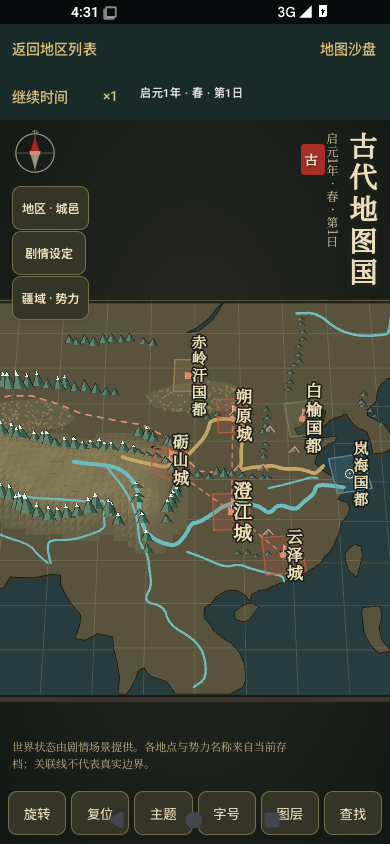
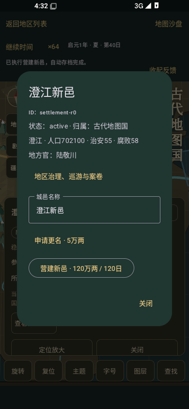
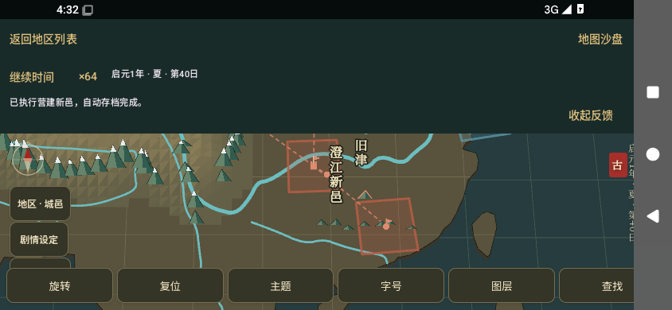
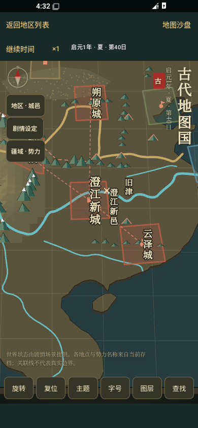
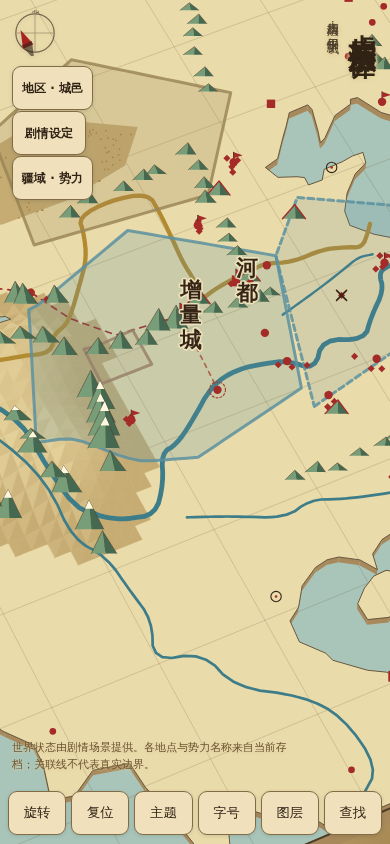
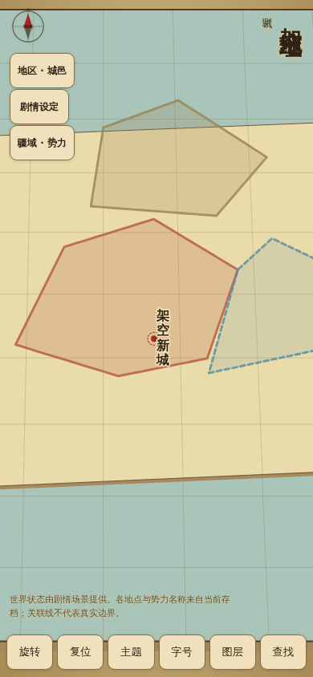

# 世界舆图 v4 实测界面

图片直接来自[0.2.1绘制与重启专项](https://github.com/initial2024/game/actions/runs/43735827719)及浏览器测试，未作合成或重绘。Android图为API35 x86_64模拟器，不是vivo手机；浏览器图单独标注。

| Android当前存档地图 | Android真实新城验收 |
| --- | --- |
|  |  |

| Android横屏 | Android真正结束进程后重新加载 |
| --- | --- |
|  |  |

| 桌面浏览器390×844 | 桌面浏览器自定义地理 |
| --- | --- |
|  |  |

[完整交付与测试报告](MAP_V4_TESTING.md)。截图展示对应测试状态；游戏数值仍由原生规则与SQLite保存。
