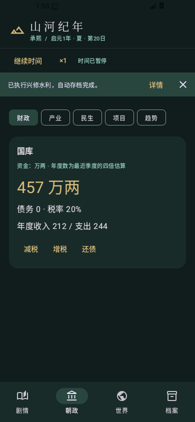
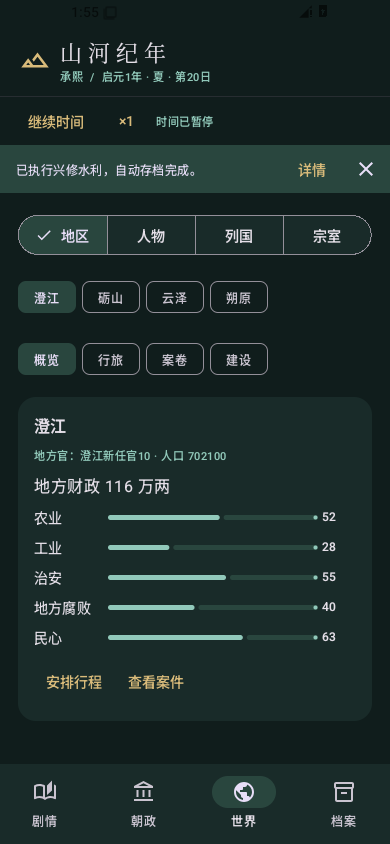
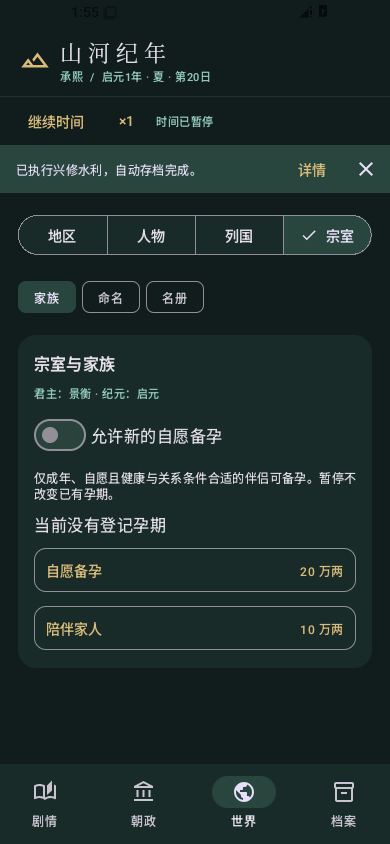
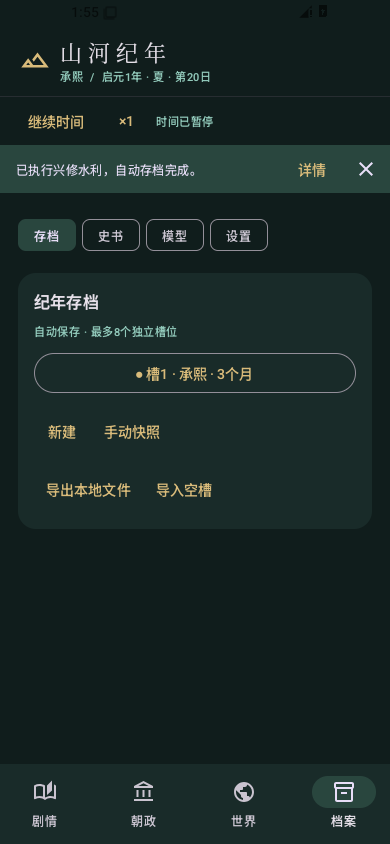
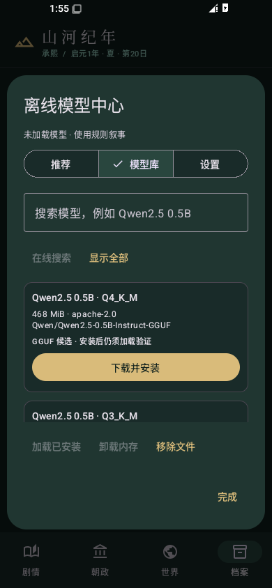
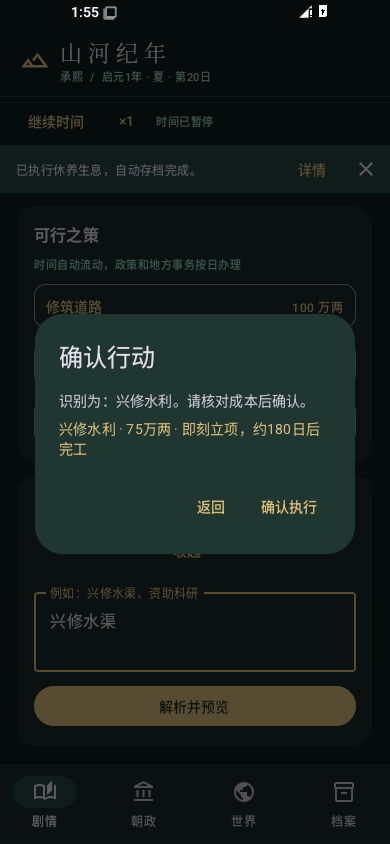
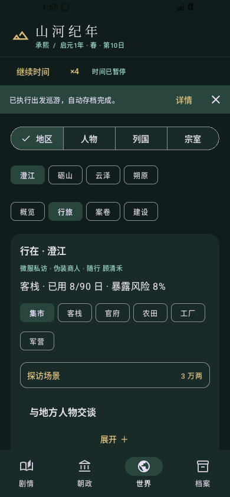
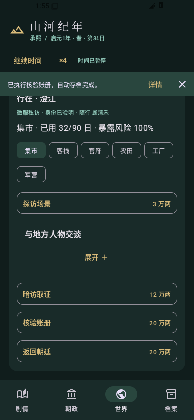
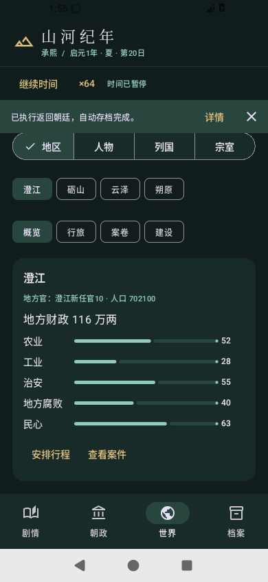

# 0.1.1-dev 实测界面

以下图片直接来自 [已通过的 Android 界面测试](https://github.com/initial2024/game/actions/runs/43721094983)。Android 15 x86_64 模拟器，390×844，密度160；图片未经合成。地图尚未接入。

| 剧情分组 | 朝政分类 |
| --- | --- |
|  |  |

| 地区概览 | 宗室 |
| --- | --- |
|  |  |

| 档案分页 | 模型中心 |
| --- | --- |
|  |  |

| 自定义行动确认 | 巡游抵达 |
| --- | --- |
|  |  |

| 案件取证 | 返回后看到新官接任 |
| --- | --- |
|  |  |

长文限高滚动、人物和档案分页、内部任务分组切换。截图仅代表对应状态，完整功能与限制见 [交付报告](TESTING.md)。
